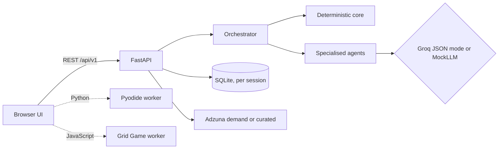
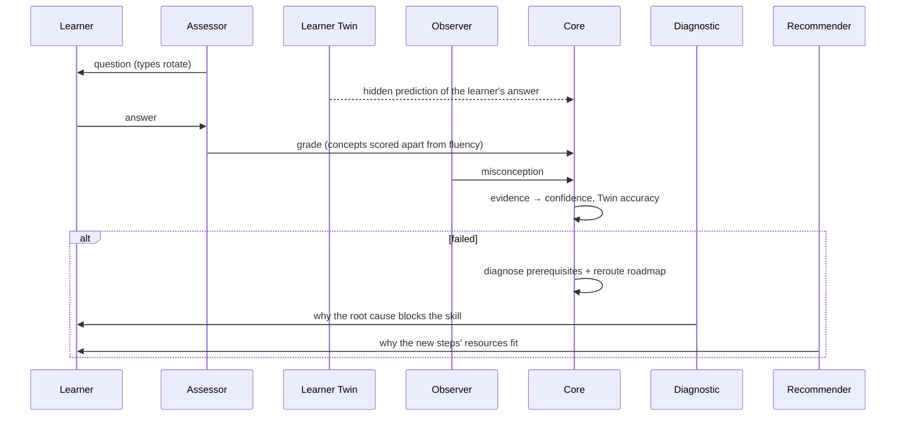

# SkillTwin

[](https://github.com/karthikeyan4747/skilltwin/actions/workflows/ci.yml)

SkillTwin is an AI learning platform for universities and employers. It works out what a
learner can actually do, what is missing for a target job role, and what to learn next. Skills
count as **verified only when evidence proves them** (assessment answers, code exercises), not
because the learner claims them. Specialised AI agents collaborate to assess, diagnose,
recommend and mentor, and the roadmap **adapts when the learner performs poorly or changes their
career goal**. A **Learner Twin** predicts each answer before the learner submits it; its
prediction accuracy is shown as a measure of how well the system models that learner.

- **Live app:** https://skilltwin-616974575902.asia-south1.run.app (the **Try the sample scenario**
  button on the Dashboard runs both adaptation loops in one click)
- **Without JavaScript:** [/about](https://skilltwin-616974575902.asia-south1.run.app/about)
  (features → UI route → API endpoints → code → tests, plus the agent roster) ·
  [/docs](https://skilltwin-616974575902.asia-south1.run.app/docs) (OpenAPI) ·
  [/api/v1/meta](https://skilltwin-616974575902.asia-south1.run.app/api/v1/meta) (the same data as JSON)
- **Vertical:** Education & Career Development
- Works fully without API keys (deterministic offline AI mode).

## Problem statement alignment

| Requirement | Implementation | UI route | Tests |
|---|---|---|---|
| 1. User Profile: learner details, skills, certifications, projects, career goal | `backend/api/routes/profile.py`, `backend/core/models.py`, `frontend/js/views/profile.js` | `#/profile` | `tests/test_api.py` |
| 2. Skill Analysis: strengths and weaknesses from skills and assessments | `backend/core/analysis.py`, `frontend/js/views/analysis.js` | `#/analysis` | `tests/core/test_analysis.py` |
| 3. Career Matching: current skills vs a job role's requirements | `backend/core/career.py`, `backend/services/jobs.py`, `frontend/js/views/career.js` | `#/career` | `tests/core/test_career.py`, `tests/test_services.py` |
| 4. Learning Recommendations: courses, tutorials, practical exercises | `backend/core/roadmap.py`, `backend/agents/recommender.py`, `backend/data/resources.json`, `frontend/js/views/roadmap.js` | `#/roadmap` | `tests/core/test_roadmap.py` |
| 5. Progress Tracking: learning progress and assessment performance | `backend/core/progress.py`, `backend/core/twin.py`, `frontend/js/views/progress.js` | `#/progress` | `tests/core/test_small_modules.py` |
| 6. AI Mentor: guidance that updates recommendations from performance | `backend/agents/mentor.py`, `backend/orchestrator/coaching.py`, `frontend/js/views/mentor.js` | `#/mentor` | `tests/test_orchestrator.py` |
| Agentic AI: specialised agents collaborate | `backend/agents/team.py`, `backend/orchestrator/__init__.py` | every AI result: "How the agents worked together" | `tests/agents/test_agents.py`, `tests/test_orchestrator.py` |
| Adapts when the learner **performs poorly** | `backend/orchestrator/assessment.py`, `backend/core/diagnosis.py`, `backend/core/roadmap.py` | `#/assessment`, then `#/roadmap` reroute history | `tests/test_orchestrator.py`, `tests/core/test_diagnosis.py` |
| Adapts when the learner **changes career goal** | `backend/orchestrator/planning.py`, `backend/core/career.py` | `#/career`, "Switch to …" | `tests/test_orchestrator.py`, `tests/core/test_career.py` |
| Sample scenario: Python, SQL, basic HTML → Full Stack Developer | `backend/data/seed_learners.json`, `backend/orchestrator/scenario.py` | `#/dashboard` (also rendered on `/` without JS) | `tests/test_sample_scenario.py`, `tests/test_site.py` |

Additional features: Assessment (MCQ, explain-back, predict-output, code exercise, work ticket),
Lessons (Python code visualizer, JavaScript grid game), Learn in Public, Institution Insights.
The full map, including every API endpoint, is generated from `backend/registry.py` and shown on
`/about`; `tests/test_docs_consistency.py` fails if a file this README names does not exist.

## Architecture



**Deterministic core, LLM at the edges.** Every decision that changes learner state (confidence,
verification, readiness, gap order, root cause, reroute, time to ready, Twin accuracy) is a pure,
typed, unit-tested function in `backend/core/`. Agents in `backend/agents/` only write, grade,
predict and explain, and their output is schema-validated before the core uses it.
`backend/orchestrator/` is the only place agents collaborate. Details:
[docs/ARCHITECTURE.md](docs/ARCHITECTURE.md).

## Run and test

```bash
python3.12 -m venv .venv && source .venv/bin/activate
pip install -e ".[dev]"
uvicorn backend.main:create_app --factory --reload   # http://localhost:8000
ruff check . && ruff format --check . && pytest --cov
```

## How it works

1. **Evidence-verified skills.** Each skill has `claimed` (self-reported) and `confidence` (0–1)
   computed only from evidence: a recency-weighted, type-weighted mean of assessment scores
   (code exercise 1.0, explain-back 0.9, predict-output 0.8, work ticket 0.8, MCQ 0.6). Confidence
   is capped at 0.6 until two different evidence types exist, so one lucky quiz cannot verify a
   skill. A skill is **verified** at ≥ 0.7. Readiness is shown twice: claimed % vs proven %.
2. **Learner Twin.** Before each answer, the Twin predicts the learner's answer and reasoning from
   their confidence, recent scores and known misconceptions. The prediction stays on the server
   and is revealed after submission; rolling accuracy is shown on the Dashboard and Progress
   pages. The Twin also answers ten simulated "day in the role" tickets to predict weak areas.
3. **Root-cause rerouting.** When an answer fails (score < 0.5), the core walks the prerequisite
   graph (HTML → CSS → JavaScript → React, …) to the deepest unverified prerequisite and moves that
   path to the front of the roadmap, logging a reroute event the learner can see.
4. **Goal change.** Verified skills carry over to the new role (`carryover_pct`) and the roadmap
   is rebuilt for the remaining gap only.

Agent collaboration when the learner answers a question:



## Agents

| Agent | Responsibility | Model tier |
|---|---|---|
| Assessor (question writer) | Writes a question of the requested type and difficulty, targeting known misconceptions | SMART |
| Assessor (grader) | Grades open answers: conceptual score (evidence) separate from fluency (feedback only) | SMART |
| Observer | Names the misconception behind a wrong answer | FAST |
| Diagnostic | Explains the core-computed root cause and a first action | FAST |
| Recommender | One-line reason why each step's course, tutorial and exercise fit | FAST |
| Learner Twin (predictor) | Predicts the learner's answer and correctness before submission | FAST |
| Learner Twin (responder) | Answers simulated work tickets as the learner would | FAST |
| Interviewer | Writes "day in the role" tickets weighted by role skills | SMART |
| Career | Summarises claimed vs proven readiness and better-fit roles | FAST |
| AI Mentor | Grounded guidance; may suggest roadmap focus that the core applies | SMART (VISION with a screenshot) |
| Publisher | Drafts a LinkedIn post and learning log from real evidence | FAST |

Every agent has typed input/output models, a prompt constant, `max_tokens`, one retry on invalid
JSON, and a runtime fallback to MockLLM. If a live call fails, the UI shows an
**Offline AI mode** badge instead of breaking; without `GROQ_API_KEY` the whole app runs on the
deterministic MockLLM.

## Security

Summary: secrets only via environment variables; signed HttpOnly session cookie; strict,
bounded, extra-forbidding request schemas; 2.5 MB body limit; screenshot allowlist, size cap and
verified decode with no persistence; per session + IP rate limits on every LLM route; strict CSP
(no inline scripts; `/docs` allows only Swagger UI's own bootstrap script by SHA-256 hash) and
security headers; learner code runs only in browser workers with timeouts;
all text rendered via `textContent`; parameterised SQL; generic client errors; pinned
dependencies; non-root container. Full details: [SECURITY.md](SECURITY.md).

## Efficiency

- **Model tiering:** FAST model for Observer, Diagnostic, Twin, Recommender, Career and
  Publisher; SMART model for Assessor, Mentor and Interviewer; VISION only when a screenshot is
  attached.
- **Models:** defaults are `openai/gpt-oss-20b` (FAST), `openai/gpt-oss-120b` (SMART) and
  `qwen/qwen3.8-27b` (VISION), overridable via env vars. For gpt-oss reasoning models the client
  requests `reasoning_effort="low"` and adds a fixed reasoning-token headroom so hidden reasoning
  cannot exhaust an agent's JSON budget.
- **TTL caches:** job-demand data (6 h), AI-written questions per (question template, difficulty)
  (1 h), and role rankings keyed by the skill-graph hash plus the claimed/verified skill sets (1 h).
- **Concurrency:** async I/O throughout; independent agents run with `asyncio.gather`; the Twin
  interview batch runs at most 4 tickets at once (`asyncio.Semaphore`). The Recommender explains
  all roadmap steps in one batched call.
- **Algorithms:** topological sort, ancestor walk and root-cause BFS are O(V+E) over the skill
  graph.
- **Frontend:** no framework or build step; views load on demand as ES modules; Pyodide (~10 MB)
  loads only when a Python feature is first used, with a progress message. Static assets are
  gzip-compressed and served with `Cache-Control: no-cache` plus ETag revalidation.
- **Hosting:** a single small container on Cloud Run with `--min-instances 0`, so it scales to zero.

## Testing

```bash
pip install -e ".[dev]"
ruff check . && ruff format --check .
pytest --cov
```

87 tests, 98% line coverage of `backend/` at the time of writing. Coverage includes every core
function and edge case (cycle detection, no evidence, all verified, single-type cap), agents with
MockLLM (invalid-JSON retry and runtime fallback), both adaptation triggers in the orchestrator,
the sample scenario (`tests/test_sample_scenario.py`), API behaviour (validation errors,
session isolation, rate limiting, body size limit, security headers, screenshot validation),
server-rendered pages and metadata (`tests/test_site.py`), and that every file the docs name
exists (`tests/test_docs_consistency.py`).
CI (`.github/workflows/ci.yml`) runs ruff check, ruff format check and pytest with coverage.

## Accessibility (WCAG 2.1 AA target)

Landmarks, skip link, one `h1` per view with focus moved to it on navigation, labelled controls
and inline form errors, visible focus ring, full keyboard operation (ARIA tablist with arrow keys,
focus-trapped modal closed by Esc), `aria-live` for results and toasts, light and dark themes via
`prefers-color-scheme`, `prefers-reduced-motion` respected (results and Grid Game animation),
icons and text alongside colour, `lang` attribute, ≥ 44 px touch targets, layouts tested at 360 px
with no horizontal scroll. Every chart, graph, visualizer and game state has a text alternative
(data table, nested list, full text trace, board description). Grading open answers on concepts
separately from fluency is an inclusive-design choice for non-native speakers.

## Assumptions

- **Seeded data:** a curated catalog of 16 skills, 5 roles, a question bank and a 24-learner
  anonymised cohort; each new session gets its own copy of the sample learner
  (Python and SQL verified, HTML claimed only, goal Full Stack Developer).
- **Ephemeral storage:** SQLite lives in the container's temp directory, so data on Cloud Run is
  per instance and is lost when the instance stops.
- **Curated resources:** courses, tutorials and exercises link to real public pages (MDN,
  freeCodeCamp, official docs, The Odin Project and others); the AI only writes the reason text.
- **MockLLM fallback:** without `GROQ_API_KEY`, or if a live call fails, agents use deterministic
  fixtures (rubric keyword coverage for grading, a confidence/misconception rule for the Twin).
- **Guest sessions:** no accounts; a signed cookie identifies the session.
- **Optional Adzuna:** with `ADZUNA_APP_ID`/`ADZUNA_APP_KEY`, demand counts are live (India job
  search) and labelled "Live"; otherwise curated counts labelled "Curated data" are shown.
- Code-exercise tests run in the browser and report pass counts, because learner code never runs
  on the server. Twin interview batches predict weak areas but do not add evidence; real "work
  ticket" answers in Assessment do.

## Local setup

Optional: `cp .env.example .env` and add `GROQ_API_KEY` (and model names) for live AI; without it
the app runs in offline AI mode. See [Run and test](#run-and-test).

## Deploy (Google Cloud Run)

```bash
gcloud run deploy skilltwin --source . --region asia-south1 --allow-unauthenticated \
  --memory 512Mi --min-instances 0 --max-instances 1 \
  --set-env-vars ENV=prod,GROQ_API_KEY=...,SESSION_SECRET=...,LLM_MODEL_FAST=openai/gpt-oss-20b,LLM_MODEL_SMART=openai/gpt-oss-120b,LLM_MODEL_VISION=qwen/qwen3.8-27b
```

`--max-instances 1` keeps every guest session on the instance that holds its SQLite data
(storage is per instance; see Assumptions). The Dockerfile builds a multi-stage
`python:3.12-slim` image, runs as a non-root user and starts uvicorn on `$PORT` with
`--proxy-headers`. Health: `/health` returns status, version and LLM mode (Cloud Run reserves
paths ending in `z`, so `/healthz` is for local use).
