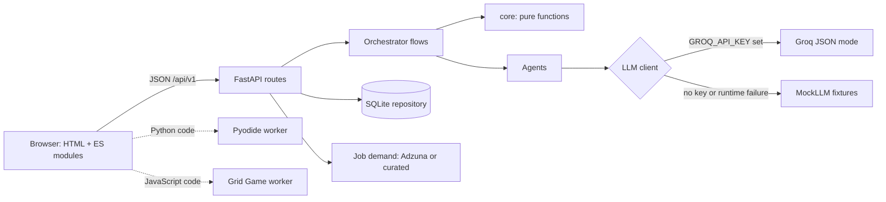
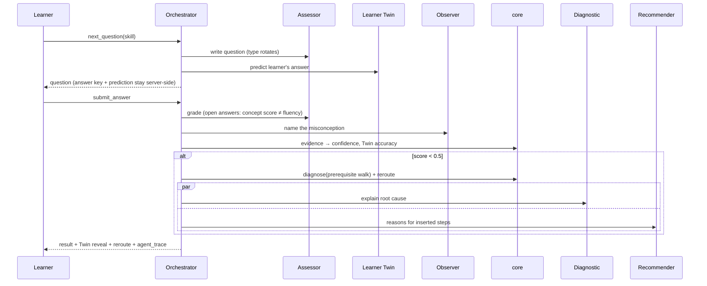
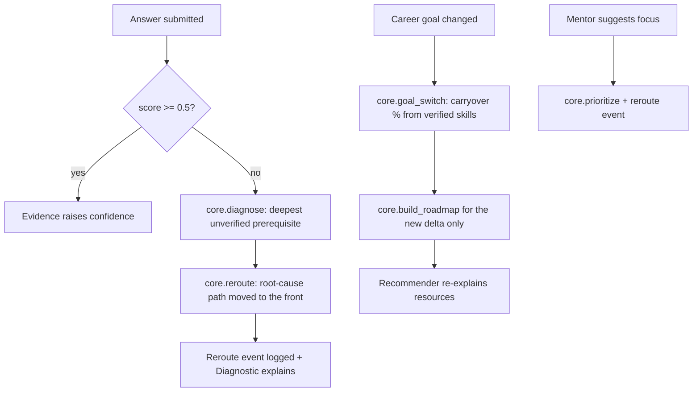

# SkillTwin architecture

SkillTwin follows one rule: **deterministic core, LLM at the edges.** Every decision that changes
a learner's state (confidence, verification, readiness, gap ordering, root cause, reroutes, time
to ready, Twin accuracy, cohort insights) is a pure, typed, unit-tested function in
`backend/core/`. Agents only write, grade, predict and explain, and their output is always
validated against a Pydantic schema before the core consumes it.

## Layers

| Layer | Path | Responsibility | Depends on |
|---|---|---|---|
| Core | `backend/core/` | Pure domain logic, no I/O, no LLM | pydantic only |
| Agents | `backend/agents/` | One specialised agent per file: typed input/output, prompt as a module constant | core models, `services/llm.py` protocol |
| Services | `backend/services/` | LLM clients (Groq + MockLLM), SQLite repository, TTL cache, job-demand lookup, catalog loader, image sanitiser | core |
| Orchestrator | `backend/orchestrator/` | The only place agents collaborate; composes core + agents into named flows | core, agents, services |
| API | `backend/api/` | FastAPI routes, request schemas, typed response views (`backend/api/views.py`), session/security middleware, error envelope, presenters, server-rendered pages (`/`, `/about`, `/docs`) | orchestrator, services |
| Registry | `backend/registry.py` | Each feature mapped to its UI route, API tag, code and tests; read by `/about`, `/api/v1/meta` and `tests/test_docs_consistency.py` | none |
| Frontend | `frontend/` | Semantic HTML, CSS tokens, vanilla ES modules, Web Workers | REST API |

## Orchestrated flows

All flows live in `backend/orchestrator/` and return an `agent_trace`
(`[{agent, purpose, duration_ms, mode}]`) that the UI shows under "How the agents worked together".

| Flow | File | Agents (in order) | Core functions |
|---|---|---|---|
| `onboard` | `planning.py` | Career ‖ Recommender | `analyze_skills`, `rank_roles`, `build_roadmap`, `carry_progress` |
| `change_goal` | `planning.py` | Career ‖ Recommender | `goal_switch`, `build_roadmap`, `log_event` |
| `next_question` | `questions.py` | Assessor (question writer) → Learner Twin (predictor) | `next_type`, `difficulty_for` |
| `submit_answer` | `assessment.py` | Assessor (grader, open answers only) → Observer → Diagnostic ‖ Recommender (on failure) | `grade_*`, `record_outcome`, `diagnose`, `reroute`, `twin_accuracy` |
| `twin_interview` | `coaching.py` | Interviewer → (Learner Twin responder → Assessor grader) × n, at most 4 concurrently | `topological` |
| `mentor_chat` | `coaching.py` | AI Mentor | `prioritize` |
| `publish_draft` | `coaching.py` | Publisher | `misconceptions_overcome`, `readiness` |
| `sample_scenario` | `scenario.py` | onboard → next_question → submit_answer (wrong on purpose) → change_goal | everything above |

`‖` means the calls run concurrently with `asyncio.gather`.

## Adaptation loops

## Evidence model (core/analysis.py)

- Evidence: `{skill_id, type, score 0–1, timestamp}`; type weights `code_exercise 1.0`,
  `explain_back 0.9`, `predict_output 0.8`, `interview 0.8`, `mcq 0.6`.
- Confidence = recency-weighted (14-day half-life) and type-weighted mean of scores.
- Capped at 0.6 unless the skill has at least two distinct evidence types.
- Verified at confidence ≥ 0.7. Claimed without evidence = 0.2; unclaimed without evidence = 0.

## Server-rendered pages

`/` is rendered from `backend/templates/index.html`. Its content area holds the sample-scenario
result computed by the core at startup (no LLM), the six required features with links, and the
two adaptation loops, so the page is meaningful before or without JavaScript. The JavaScript
router replaces that content with the interactive view. `/about` lists every feature with its
UI route, the API endpoints read from the app's OpenAPI schema, the implementing files and
tests, and the agent roster read from `AgentTeam.roster()`. `/api/v1/meta` returns the same as JSON.

## Data and state

- Static catalog in `backend/data/*.json` is validated on load (the skill graph must be a DAG and
  roles may only reference known skills).
- Each guest session gets its own copy of the sample learner, stored as one JSON document per
  session in SQLite. Pending questions (answer key + Twin prediction) are stored per session and
  deleted when answered. Misconceptions are stored under an anonymised hash for cohort insights.
- SQLite lives in the container's temp directory, so on Cloud Run it is ephemeral per instance.
